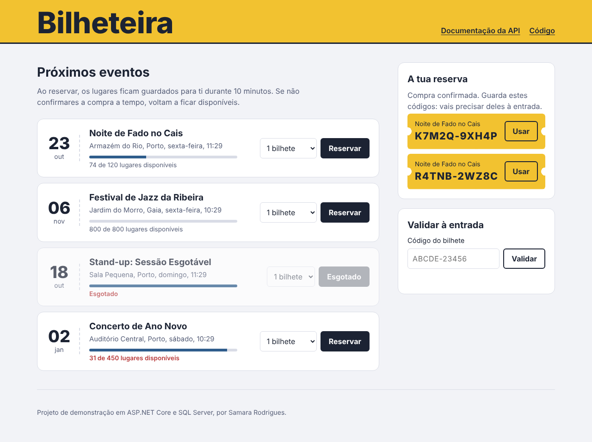
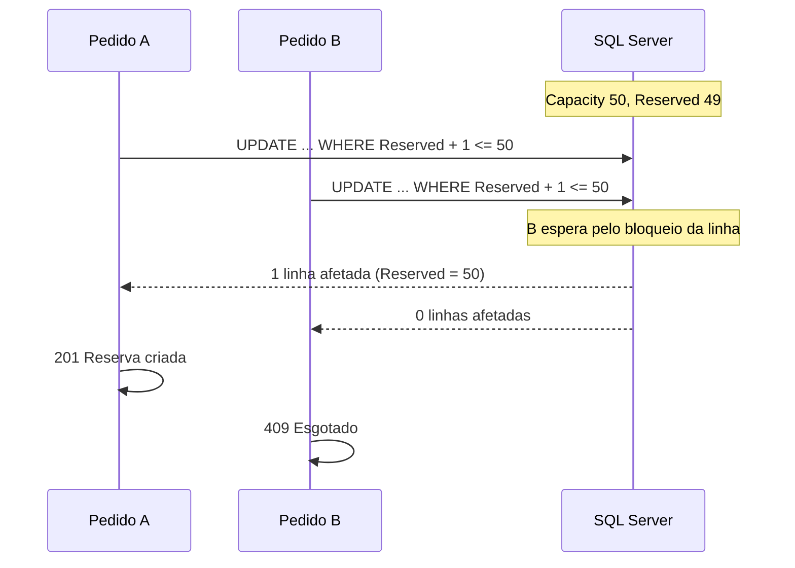

# Bilheteira

[](https://github.com/Samrodrigues015/bilheteira/actions/workflows/ci.yml)

API de venda de bilhetes em ASP.NET Core e SQL Server, com uma página de demonstração.
O foco do projeto é um problema concreto: **não vender mais bilhetes do que a lotação, mesmo quando centenas de pessoas compram ao mesmo tempo.**



## O problema

Num sistema de bilhética, os picos de procura são o momento crítico: abre a venda de um concerto e chegam centenas de pedidos no mesmo segundo. A abordagem ingénua é esta:

```csharp
var evento = await db.Events.FindAsync(id);
if (evento.Available >= quantidade)       // dois pedidos leem "1 lugar livre"...
{
    evento.Reserved += quantidade;          // ...e os dois reservam-no
    await db.SaveChangesAsync();
}
```

Entre o `if` e o `SaveChanges` há uma janela em que outro pedido pode ler o mesmo valor. Com tráfego real, isto vende bilhetes a mais.

## A solução

Cada mudança de estado é um **UPDATE condicional**, executado de forma atómica pela base de dados:

```sql
UPDATE Events
SET    Reserved = Reserved + @quantidade
WHERE  Id = @id AND Reserved + @quantidade <= Capacity
```

O SQL Server bloqueia a linha enquanto executa o UPDATE, por isso os pedidos concorrentes passam um de cada vez. Quem chega quando já não há lugares recebe *0 linhas afetadas* e a API responde `409 Esgotado`.



O mesmo padrão resolve as outras corridas do sistema:

| Situação | UPDATE condicional |
|---|---|
| Reservar lugares | `Reserved + q <= Capacity` |
| Confirmar compra | `Status = Pending AND ExpiresAt > agora` |
| Expirar reserva | `Status = Pending` (se o cliente confirmou entretanto, não mexe) |
| Validar bilhete à entrada | `CheckedInAt IS NULL` (o mesmo código lido em duas portas só entra uma vez) |

Como última linha de defesa, uma *check constraint* na tabela `Events` garante `0 <= Reserved <= Capacity`: mesmo com um bug no código, a base de dados recusa vender acima da lotação.

## Funcionalidades

- **Reserva temporária**: os lugares ficam presos durante 10 minutos à espera de confirmação.
- **Expiração automática**: um `BackgroundService` liberta os lugares das reservas não confirmadas.
- **Confirmação idempotente**: confirmar duas vezes (duplo clique, retry de rede) devolve os mesmos bilhetes, sem emitir novos.
- **Bilhetes com código legível** (`K7M2Q-9XH4P`), gerados com `RandomNumberGenerator` e sem caracteres ambíguos (0/O, 1/I/L).
- **Check-in** à entrada, com proteção contra uso duplicado.
- **Erros no formato ProblemDetails** (RFC 9457), com um `code` para o front-end reagir.
- **Documentação interativa da API** com OpenAPI e Scalar.

## Testes

Os testes de integração correm contra um **SQL Server real**, num contentor criado com [Testcontainers](https://dotnet.testcontainers.org/). O provider InMemory do EF Core não serviria: o que está a ser testado (bloqueios, atomicidade, constraints) é comportamento da base de dados.

O teste principal lança **200 pedidos em simultâneo para um evento com 50 lugares** e verifica que exatamente 50 são aceites e 150 recusados.

Para testar a expiração sem esperar 10 minutos, a aplicação usa a abstração `TimeProvider` do .NET; nos testes é substituída por um relógio que se pode avançar.

```bash
dotnet test        # precisa do Docker a correr
```

O GitHub Actions corre o build e os testes em cada push.

## Como correr

**Com Docker (tudo de uma vez):**

```bash
docker compose up --build
```

Abre http://localhost:8080 para a página de demonstração e http://localhost:8080/scalar para a documentação da API.

**Para desenvolver (Visual Studio ou `dotnet run`):**

```bash
docker compose up -d sqlserver
dotnet run --project src/Bilheteira.Api
```

A base de dados é criada no arranque e carregada com eventos de exemplo.

## Endpoints

| Método | Rota | Descrição |
|---|---|---|
| `GET` | `/api/events` | Lista os eventos com os lugares disponíveis |
| `GET` | `/api/events/{id}` | Detalhe de um evento |
| `POST` | `/api/events` | Cria um evento |
| `POST` | `/api/events/{id}/reservations` | Reserva lugares (`{ "quantity": 2 }`) |
| `GET` | `/api/reservations/{id}` | Estado de uma reserva |
| `POST` | `/api/reservations/{id}/confirm` | Confirma a compra e emite os bilhetes |
| `GET` | `/api/tickets/{code}` | Detalhe de um bilhete |
| `POST` | `/api/tickets/{code}/check-in` | Valida o bilhete à entrada |

## Decisões técnicas

**UPDATE condicional em vez de concorrência otimista com `rowversion`.** Com `rowversion`, os pedidos concorrentes falham com `DbUpdateConcurrencyException` e têm de tentar outra vez. Num pico de procura isso gera muitas tentativas repetidas e, com um limite de tentativas, pode recusar pedidos quando ainda há lugares. O UPDATE condicional não precisa de retries: cada pedido é aceite ou recusado à primeira, e o resultado é determinístico.

**Um contador na tabela `Events` em vez de somar reservas.** Calcular os lugares livres com `SUM(Quantity)` a cada pedido obrigaria a transações serializáveis para ser seguro. Um contador atualizado atomicamente é mais simples e mais rápido.

**Um só projeto, organizado por funcionalidade** (`Events/`, `Reservations/`, `Tickets/`). Para este tamanho, separar em camadas (Domain, Application, Infrastructure) seria cerimónia sem benefício. Se o sistema crescesse, a organização por funcionalidade facilita extrair cada parte.

**`EnsureCreated` em vez de migrations.** Chega para um projeto de demonstração. Em produção usaria migrations do EF Core para evoluir o esquema sem perder dados.

**GUID v7 como chave primária** (`Guid.CreateVersion7()`). São ordenados no tempo, o que evita a fragmentação do índice clustered que os GUIDs aleatórios causam no SQL Server.

## Próximos passos

- Pagamento com Stripe em modo de teste, com *idempotency keys*
- QR code nos bilhetes
- Teste de carga com k6
- Rate limiting nos endpoints de reserva
- Migrations do EF Core
- Deploy com demo pública

## Stack

.NET 10, ASP.NET Core, EF Core 10, SQL Server 2022, xUnit, Testcontainers, Docker, GitHub Actions.
