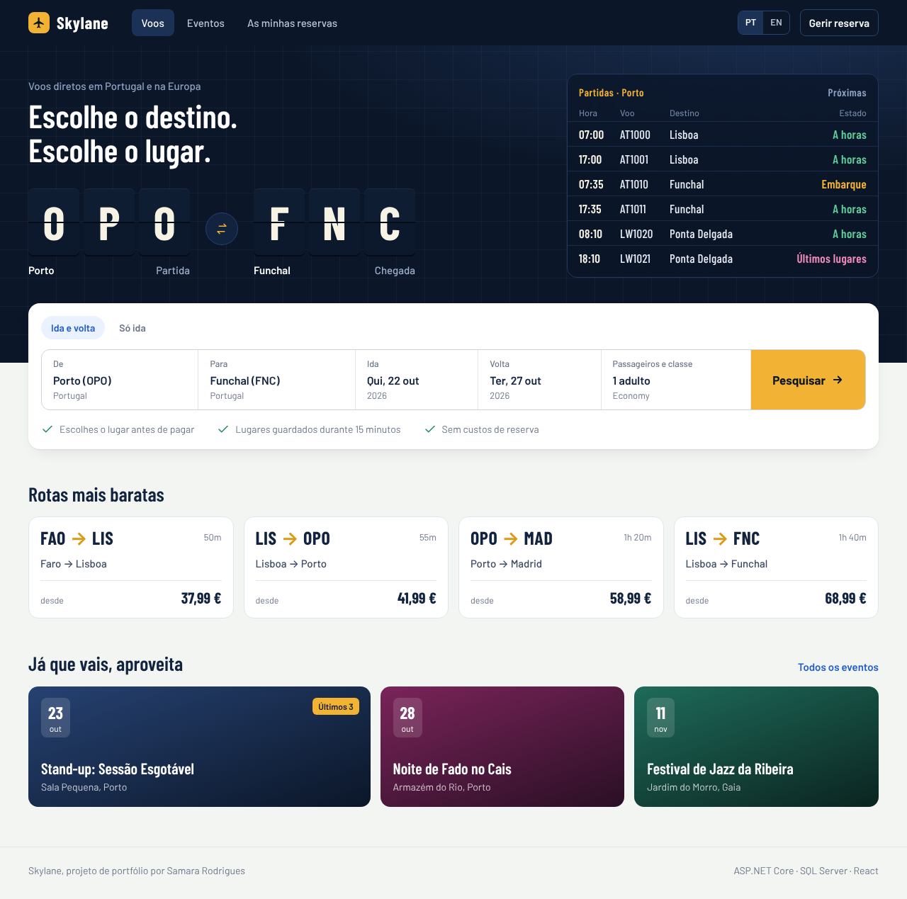
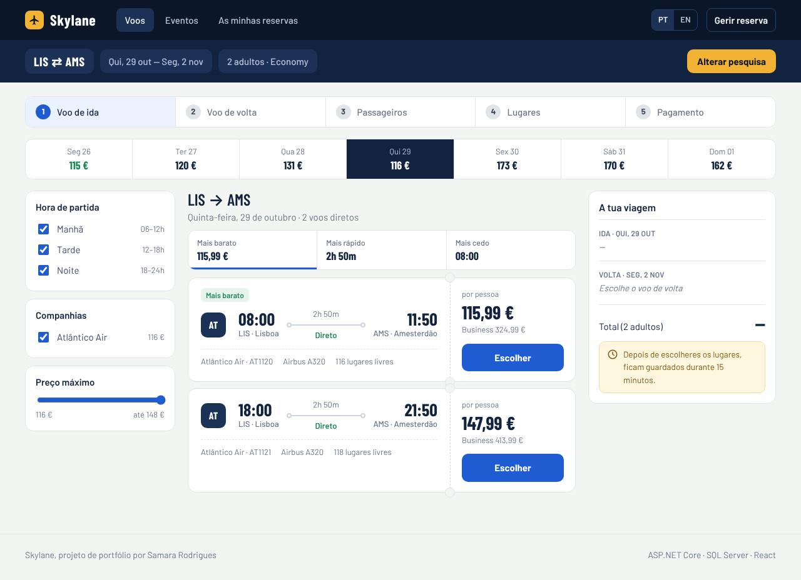
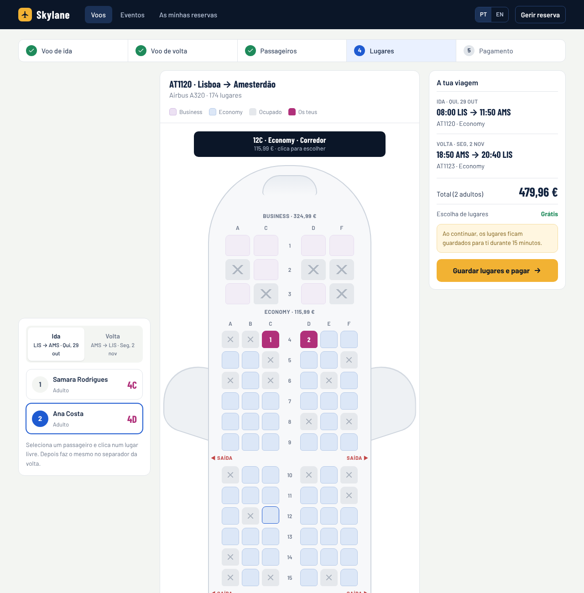
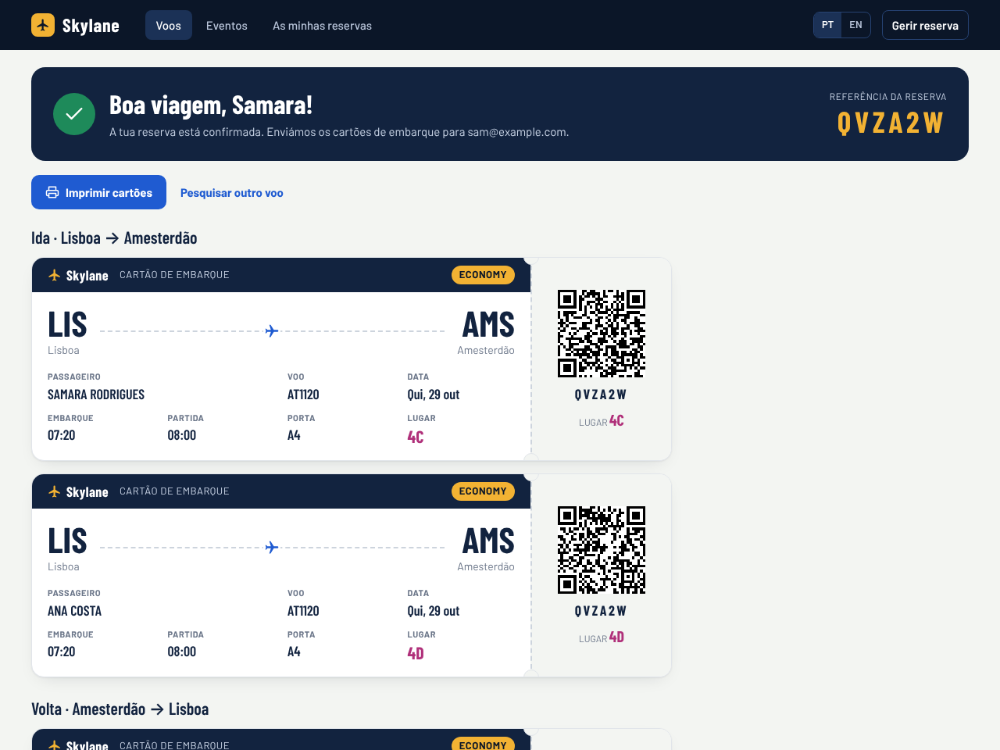
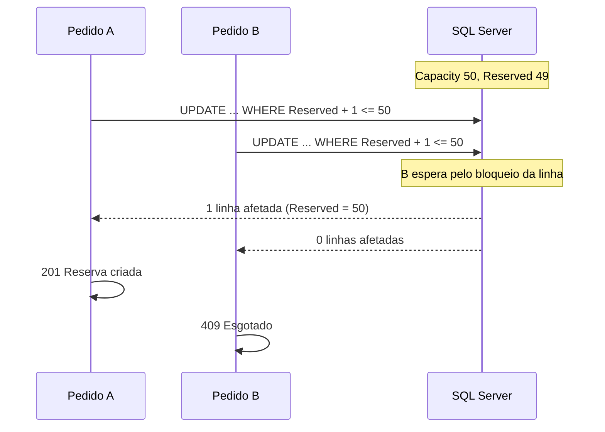
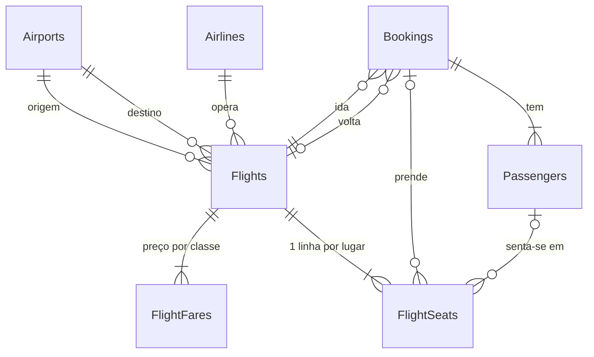

# Skylane

[](https://github.com/Samrodrigues015/Skylane/actions/workflows/ci.yml)

Site de reserva de **voos** e **eventos**, com API em ASP.NET Core e SQL Server e front-end em React + TypeScript, em português e inglês.
O foco do projeto é um problema concreto: **não vender mais bilhetes do que existem, mesmo quando centenas de pessoas compram ao mesmo tempo.**

- **Eventos**: lotação sem lugares marcados (um contador por evento).
- **Voos**: lugares marcados num mapa do avião, reservas de ida e volta e horas locais de cada aeroporto.

**[▶ Ver a demo ao vivo](https://skylane.blueisland-b99c3c8d.switzerlandnorth.azurecontainerapps.io)** · cartão de teste `4242 4242 4242 4242`

> A demo corre no escalão gratuito do Azure e desliga-se quando ninguém a usa: a primeira visita pode demorar até um minuto a arrancar.



| Resultados da pesquisa | Escolha de lugares | Cartões de embarque |
|---|---|---|
|  |  |  |

## O problema

Num sistema de bilhética, os picos de procura são o momento crítico: abre a venda de um concerto e chegam centenas de pedidos no mesmo segundo. A abordagem ingénua é esta:

```csharp
var evento = await db.Events.FindAsync(id);
if (evento.Available >= quantidade)       // dois pedidos leem "1 lugar livre"...
{
    evento.Reserved += quantidade;          // ...e os dois reservam-no
    await db.SaveChangesAsync();
}
```

Entre o `if` e o `SaveChanges` há uma janela em que outro pedido pode ler o mesmo valor. Com tráfego real, isto vende bilhetes a mais.

## A solução

Cada mudança de estado é um **UPDATE condicional**, executado de forma atómica pela base de dados:

```sql
UPDATE Events
SET    Reserved = Reserved + @quantidade
WHERE  Id = @id AND Reserved + @quantidade <= Capacity
```

O SQL Server bloqueia a linha enquanto executa o UPDATE, por isso os pedidos concorrentes passam um de cada vez. Quem chega quando já não há lugares recebe *0 linhas afetadas* e a API responde `409 Esgotado`.



O mesmo padrão resolve as outras corridas do sistema:

| Situação | UPDATE condicional |
|---|---|
| Reservar lugares | `Reserved + q <= Capacity` |
| Confirmar compra | `Status = Pending AND ExpiresAt > agora` |
| Expirar reserva | `Status = Pending` (se o cliente confirmou entretanto, não mexe) |
| Validar bilhete à entrada | `CheckedInAt IS NULL` (o mesmo código lido em duas portas só entra uma vez) |

Como última linha de defesa, uma *check constraint* na tabela `Events` garante `0 <= Reserved <= Capacity`: mesmo com um bug no código, a base de dados recusa vender acima da lotação.

## Voos: lugares marcados

Nos voos o cliente escolhe o lugar no mapa do avião (o 12A, o 12B...). Em vez de um contador, há **uma linha por lugar e por voo** na tabela `FlightSeats`, e cada lugar é preso com o mesmo padrão:

```sql
UPDATE FlightSeats
SET    Status = 'Held', BookingId = @reserva, PassengerId = @passageiro
WHERE  FlightId = @voo AND SeatNumber = '12A' AND Status = 'Available'
```

Uma reserva pode prender vários lugares em dois voos (ida e volta), por isso tudo acontece numa transação: **se um único lugar falhar, nada fica reservado**.

### Modelo de dados



Decisões que vale a pena destacar:

- **Chave primária composta `(FlightId, SeatNumber)` em `FlightSeats`.** Sendo clustered, os lugares de um voo ficam juntos no disco, e o mapa do avião lê só essa zona da tabela.
- **Voos criados a pedido.** Ter voos para as 110 combinações de aeroportos durante um ano seriam ~80 000 voos e 14 milhões de lugares. Em vez disso, quando alguém pesquisa uma rota e um dia sem voos, o `FlightSchedule` cria-os nesse momento a partir de um horário determinístico (`FlightTimetable`): o mesmo dia gera sempre as mesmas horas e preços, e a duração das rotas novas é estimada pela distância entre aeroportos. Duas pesquisas simultâneas não criam voos repetidos, graças a um `sp_getapplock` por rota.
- **Lugares criados com um único `INSERT ... SELECT ... CROSS JOIN`.** 30 dias de voos são ~270 000 lugares; o EF objeto a objeto demoraria minutos, um só comando SQL demora segundos.
- **Ordem fixa ao prender lugares.** Se uma reserva pede `[16A, 16B]` e outra `[16B, 16A]` ao mesmo tempo, cada uma podia ficar com um lugar à espera do outro (deadlock). Os lugares são sempre presos pela mesma ordem, e um teste com 30 pedidos cruzados confirma que não há deadlocks.
- **Constraints que protegem os dados mesmo com bugs no código**: um lugar livre não pode ter dono (`CK_FlightSeats_OwnerMatchesStatus`); um passageiro não pode ter dois lugares no mesmo voo (índice único **filtrado** `WHERE PassengerId IS NOT NULL`); a chegada tem de ser depois da partida.
- **Horas em UTC na base de dados, hora local na API.** Cada aeroporto tem o seu fuso (`Europe/Lisbon`, `Atlantic/Azores`, `Europe/Madrid`...). Um voo Lisboa → Madrid que parte às 10:00 e voa 75 minutos chega às 12:15 hora de Madrid, e há testes para isso.
- **Preço calculado sem ler os lugares.** A classe de cada lugar vem do layout do avião (filas 1–3 são Business), por isso o total é calculado antes da transação e não bloqueia em lugares que outra reserva está a prender.

## Front-end

React 19 + TypeScript, criado com Vite. Fica em `src/Skylane.Web` e o build vai para o `wwwroot` da API, por isso em produção é tudo servido pelo mesmo processo.

O percurso de compra segue o de um site de viagens a sério:

1. **Pesquisa** com aeroportos, datas, ida e volta e passageiros. A página inicial mostra um painel de partidas e as rotas mais baratas, vindos da API.
2. **Resultados** com uma faixa de datas e o preço mais baixo de cada dia, filtros por hora, companhia e preço, e ordenação.
3. **Passageiros**, com validação.
4. **Lugares** num mapa do avião desenhado a partir da API. Ao continuar, os lugares ficam presos durante 15 minutos. Se alguém ficar com um deles entretanto, o mapa é recarregado e o erro é explicado.
5. **Pagamento** com contagem decrescente e cartões de teste.
6. **Cartões de embarque** com QR code, prontos a imprimir.

Em todo o percurso (página inicial, resultados e confirmação) aparecem os **eventos da cidade de destino durante as datas da viagem**. Cada evento pertence ao aeroporto da sua cidade, por isso a ligação entre voos e eventos é só um filtro por `AirportCode` e datas. Se não houver nada nessas datas, mostra os próximos eventos da cidade.

Algumas decisões:

- **Eventos com descrição em PT e EN.** A API devolve a descrição no idioma do `Accept-Language`, que o front-end envia com o idioma escolhido. A explicação de cada tipo de evento (o que é o fado, o flamenco...) fica no front-end, junto das outras traduções.
- **Horas locais tratadas como texto.** A API devolve `2026-11-20T10:00:00+00:00` na hora do aeroporto. Passar isto por `new Date()` mostraria a hora no fuso de quem está a ver, por isso as horas são lidas diretamente da string.
- **Erros traduzidos pelo `code`** do ProblemDetails (`seat_unavailable`, `card_declined`...), em vez de mostrar a mensagem da API.
- **Estado da compra em `sessionStorage`**, para um refresh a meio não perder o que já foi escolhido.
- **TanStack Query** para os pedidos à API, **react-i18next** para PT/EN e **CSS Modules** com variáveis de design, sem biblioteca de componentes.

### Pagamento fictício

O pagamento passa por uma interface `IPaymentGateway`. A implementação `FakePaymentGateway` valida o número com o algoritmo de Luhn e reage aos cartões de teste no estilo da Stripe:

| Cartão | Resultado |
|---|---|
| `4242 4242 4242 4242` | Aprovado |
| `4000 0000 0000 0002` | Recusado |
| `4000 0000 0000 9995` | Sem saldo |

Só se guardam os últimos 4 dígitos. Pagar uma reserva já confirmada devolve a mesma reserva, sem cobrar outra vez. Se o pagamento for aprovado mas a reserva já não puder ser confirmada, o pagamento fica marcado como reembolsado.

Trocar por um gateway real seria implementar a mesma interface.

### Carrinho: voos e eventos juntos

Os bilhetes para eventos vão para um **carrinho** (no browser, como numa loja online: ainda não prendem lugares). No carrinho pode-se:

- **Juntar um voo**: o site sugere voos para a cidade do evento, com chegada na véspera. Ao escolher os lugares do avião, o carrinho segue no mesmo pedido à API e é tudo reservado de uma vez **ou nada**: se um evento esgotar entretanto, nenhum lugar do avião fica preso.
- **Pagar só os bilhetes**, sem voo.

Em ambos os casos é criada uma única reserva com o mesmo prazo para tudo (15 minutos) e um único pagamento confirma os voos e emite os bilhetes, que aparecem com QR code junto aos cartões de embarque. No passo do pagamento ainda se podem juntar outros eventos no destino durante a estadia.

## Funcionalidades

- **Reserva temporária**: os lugares ficam presos à espera de confirmação (10 minutos nos eventos, 15 nos voos).
- **Expiração automática**: um `BackgroundService` liberta os lugares das reservas não confirmadas.
- **Pagamento idempotente**: pagar duas vezes ao mesmo tempo (duplo clique, retry de rede) cobra uma só vez e devolve os mesmos bilhetes. Um lock por reserva (`sp_getapplock`) faz o segundo pedido esperar pelo primeiro.
- **Só se confirma pagando**: não há nenhum endpoint para confirmar uma reserva sem pagamento.
- **Bilhetes com código legível** (`K7M2Q-9XH4P`), gerados com `RandomNumberGenerator` e sem caracteres ambíguos (0/O, 1/I/L).
- **Check-in** à entrada, com proteção contra uso duplicado.
- **Erros no formato ProblemDetails** (RFC 9457), com um `code` para o front-end reagir.
- **Documentação interativa da API** com OpenAPI e Scalar.

## Testes

Os testes de integração correm contra um **SQL Server real**, num contentor criado com [Testcontainers](https://dotnet.testcontainers.org/). O provider InMemory do EF Core não serviria: o que está a ser testado (bloqueios, atomicidade, constraints) é comportamento da base de dados.

O teste principal lança **200 pedidos em simultâneo para um evento com 50 lugares** e verifica que exatamente 50 são aceites e 150 recusados. Nos voos, **40 pessoas escolhem o mesmo lugar ao mesmo tempo** e só uma consegue.

Para testar a expiração sem esperar 10 minutos, a aplicação usa a abstração `TimeProvider` do .NET; nos testes é substituída por um relógio que se pode avançar.

```bash
dotnet test        # precisa do Docker a correr
```

O GitHub Actions corre, em cada push, o build e os testes da API, a verificação de tipos e o build do front-end e o build da imagem Docker.

## Como correr

**Com Docker (tudo de uma vez):**

```bash
docker compose up --build
```

Abre http://localhost:8080 para o site e http://localhost:8080/scalar para a documentação da API.

**Para desenvolver (Visual Studio ou `dotnet run`):**

```bash
docker compose up -d sqlserver
dotnet run --project src/Skylane.Api
```

Noutro terminal, o front-end com hot reload (precisa do Node 20 ou mais recente):

```bash
cd src/Skylane.Web
npm install
npm run dev
```

Abre http://localhost:5173. O Vite reencaminha os pedidos `/api` para a API em http://localhost:5080.

A base de dados é criada no arranque e carregada com eventos de exemplo, 11 aeroportos reais, duas companhias fictícias e voos das rotas principais para os próximos 30 dias. O primeiro arranque demora alguns segundos a gerar os lugares.

Qualquer outra combinação de aeroportos e qualquer dia até um ano à frente também tem voos: são criados no momento da primeira pesquisa (ver *Voos criados a pedido* mais acima).

A demo mantém-se sempre atual sozinha: um `BackgroundService` (`DemoDataRefresher`) corre no arranque e de 6 em 6 horas e acrescenta os voos das rotas principais dos próximos 30 dias e as sessões dos eventos dos próximos 120 dias (cada evento repete-se a um ritmo fixo). Seja qual for o dia em que alguém abre o site, há voos e bilhetes à venda.

> Se já tinhas a base de dados de uma versão anterior, apaga-a com `docker compose down` antes de arrancar: o `EnsureCreated` só cria tabelas numa base de dados nova.

## Publicação

A demo está no **Azure**, a custo zero:

- **Azure Container Apps** corre a imagem Docker (API + site React). Escala para zero quando não há visitas e arranca sozinha no pedido seguinte.
- **Azure SQL Database** com a oferta gratuita (serverless): entra em pausa quando não é usada e nunca passa do limite gratuito.
- **GitHub Actions** compila, corre os testes e publica a imagem no GitHub Container Registry (`ghcr.io/samrodrigues015/skylane`) em cada push para `main`.

Como a base de dados pode estar em pausa, a API espera que ela acorde (até ~90 s) em vez de falhar, e o site mostra "A acordar o servidor…" enquanto isso.

## Endpoints

| Método | Rota | Descrição |
|---|---|---|
| `GET` | `/api/events?city=AMS&from=2026-11-20&to=2026-11-25` | Próximos eventos, opcionalmente numa cidade e entre duas datas |
| `GET` | `/api/events/{id}` | Detalhe de um evento |
| `POST` | `/api/events` | Cria um evento |
| `POST` | `/api/events/{id}/reservations` | Reserva lugares (`{ "quantity": 2 }`) |
| `GET` | `/api/reservations/{id}` | Estado de uma reserva |
| `POST` | `/api/reservations/{id}/pay` | Paga os bilhetes com cartão (fictício) e emite-os |
| `GET` | `/api/tickets/{code}` | Detalhe de um bilhete |
| `POST` | `/api/tickets/{code}/check-in` | Valida o bilhete à entrada |
| `GET` | `/api/airports` | Lista os aeroportos |
| `GET` | `/api/flights/search?from=OPO&to=FNC&date=2026-11-20&passengers=2` | Voos diretos num dia, com preço e lugares livres por classe |
| `GET` | `/api/flights/{id}/seats` | Mapa de lugares do voo |
| `POST` | `/api/flights` | Cria um voo e todos os seus lugares |
| `POST` | `/api/bookings` | Cria a reserva do carrinho: voos (só ida ou ida e volta), bilhetes para eventos, ou os dois |
| `GET` | `/api/bookings/{reference}` | Consulta uma reserva pela referência (ex.: `K7M2Q9`) |
| `POST` | `/api/bookings/{reference}/events` | Junta bilhetes de um evento à viagem (`{ "eventId": "...", "quantity": 2 }`) |
| `DELETE` | `/api/bookings/{reference}/events/{reservationId}` | Retira o evento da viagem e devolve os lugares |
| `POST` | `/api/bookings/{reference}/pay` | Paga a viagem (voos e eventos) e emite cartões de embarque e bilhetes |
| `GET` | `/api/flights/calendar?from=LIS&to=AMS&start=2026-11-20&days=7&passengers=1` | Preço mais baixo de cada dia |
| `GET` | `/api/flights/deals?limit=4` | Rotas mais baratas dos próximos dias |
| `GET` | `/api/airports/{code}/departures?limit=6` | Próximas partidas de um aeroporto |

## Decisões técnicas

**UPDATE condicional em vez de concorrência otimista com `rowversion`.** Com `rowversion`, os pedidos concorrentes falham com `DbUpdateConcurrencyException` e têm de tentar outra vez. Num pico de procura isso gera muitas tentativas repetidas e, com um limite de tentativas, pode recusar pedidos quando ainda há lugares. O UPDATE condicional não precisa de retries: cada pedido é aceite ou recusado à primeira, e o resultado é determinístico.

**Um contador na tabela `Events` em vez de somar reservas.** Calcular os lugares livres com `SUM(Quantity)` a cada pedido obrigaria a transações serializáveis para ser seguro. Um contador atualizado atomicamente é mais simples e mais rápido.

**Um só projeto, organizado por funcionalidade** (`Events/`, `Reservations/`, `Tickets/`, `Flights/`, `Bookings/`). Para este tamanho, separar em camadas (Domain, Application, Infrastructure) seria cerimónia sem benefício. Se o sistema crescesse, a organização por funcionalidade facilita extrair cada parte.

**`EnsureCreated` em vez de migrations.** Chega para um projeto de demonstração. Em produção usaria migrations do EF Core para evoluir o esquema sem perder dados.

**GUID v7 como chave primária** (`Guid.CreateVersion7()`). São ordenados no tempo, o que evita a fragmentação do índice clustered que os GUIDs aleatórios causam no SQL Server.

## Próximos passos

- Testes end-to-end do front-end com Playwright
- *Idempotency keys* no pagamento
- Teste de carga com k6
- Rate limiting nos endpoints de reserva
- Migrations do EF Core

## Stack

**Back-end:** .NET 10, ASP.NET Core, EF Core 10, SQL Server 2022, xUnit, Testcontainers.

**Front-end:** React 19, TypeScript, Vite, TanStack Query, React Router, react-i18next, CSS Modules. Fotografias dos eventos do [Unsplash](https://unsplash.com) (licença Unsplash).

**Infraestrutura:** Docker (build em três fases: Node, SDK do .NET e runtime), Docker Compose, GitHub Actions.
